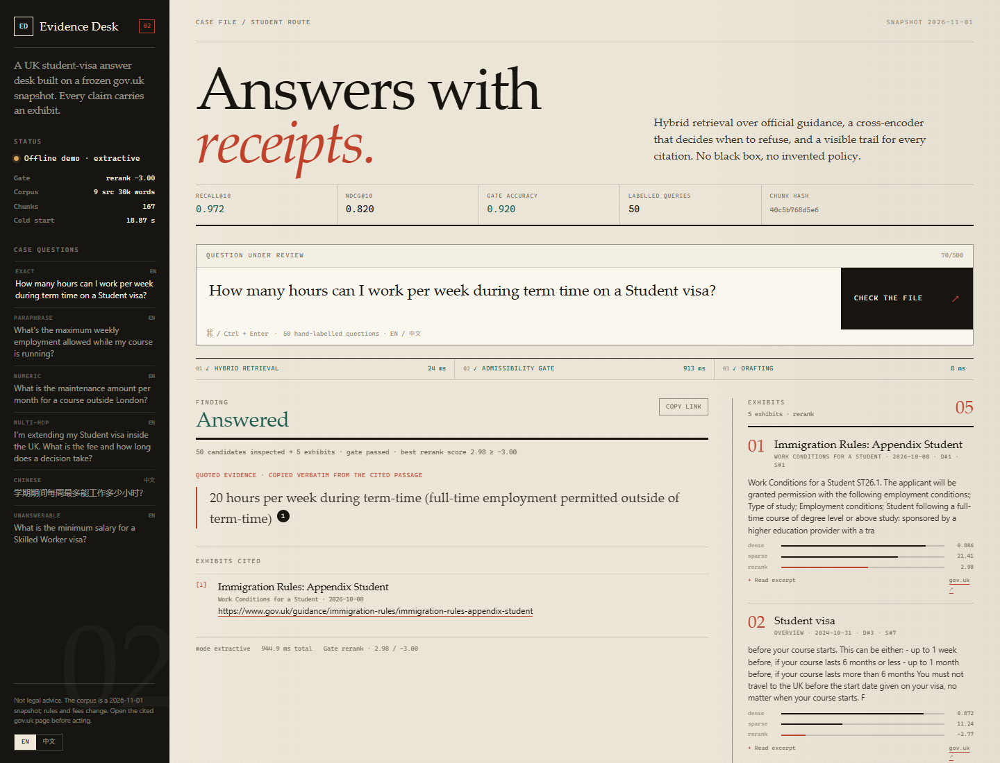

# Evidence Desk — UK Student Visa RAG

A cited assistant for international students asking UK student-visa questions.
It retrieves from a frozen gov.uk snapshot, decides when the corpus cannot
answer, and shows the evidence behind every claim.

This is not another "embed and prompt" demo. The point of the repository is the
**reproducible evidence**: retrieval metrics, refusal calibration, failure
incidents, latency distributions, memory, cost accounting, and the trade-offs
behind each choice.



## What it does

- **Answers with receipts.** Inline `[n]` markers map to the exact chunk, section,
  update date, and gov.uk URL.
- **Refuses out-of-domain questions.** A multilingual cross-encoder scores the
  top hybrid candidates; the best score decides answer/refuse. On the held-out
  test split it refuses 2 of 4 unanswerable questions with zero answerable
  over-refusals.
- **Works without an API key.** The shipped demo uses a deterministic extractive
  generator: verbatim, cited quotes. With a key, a chat model composes the answer
  and still uses the same citations.
- **Shows its work.** The UI exposes retrieval candidates, dense/sparse/rerank
  scores, the gate score vs threshold, and stage timings.
- **Fails loudly.** Missing/corrupt data, exhausted model retries, and empty
  responses have distinct error states — an outage is never rendered as a
  relevance refusal.

## Results

Corpus: **9 gov.uk sources, 74 sections, 30,035 words, 167 chunks**.
Eval: **50 queries** (42 answerable, 8 unanswerable), 25/25 dev/test, 1–4
chunk-level labels per answerable query.

### Retrieval (held-out test split, k=10, 95% bootstrap CI)

| System | recall@10 | nDCG@10 | MRR | hit@10 |
|---|---|---|---|---|
| BM25 | 0.770 [0.603, 0.905] | 0.658 | 0.718 | 0.857 |
| Dense (multilingual E5-small) | 0.901 [0.778, 0.988] | 0.791 | 0.817 | 0.952 |
| **Hybrid (RRF)** | **0.972 [0.929, 1.000]** | **0.820** | **0.845** | **1.000** |
| Hybrid + rerank reorder | 0.988 | 0.808 | 0.771 | 1.000 |
| Hybrid + rerank **gate** | 0.972 | 0.820 | 0.845 | 1.000 |

### Refusal gate (reranker score threshold `-3.0`)

| Split | Unanswerable refused | Answerable over-refused | Gate accuracy |
|---|---:|---:|---:|
| Dev (used to select threshold) | 0.750 | 0.000 | 0.960 |
| **Test (held out)** | **0.500** | **0.000** | **0.920** |

The reordering variant is a documented negative result: it raises recall but
lowers MRR/nDCG, so the shipped gate uses the cross-encoder only for the
answer/refuse decision. Scalar dense/BM25 thresholds were calibrated and failed
(0% refusal or 33–38% over-refusal).

### Bilingual behaviour (test, hybrid recall@10)

| System | Chinese | English exact | English paraphrase |
|---|---:|---:|---:|
| BM25 | 0.250 | 1.000 | 0.900 |
| Dense | 1.000 | 1.000 | 0.800 |
| Hybrid | 1.000 | 1.000 | 1.000 |

### Performance and cost (CPU, single client)

| Item | Measurement |
|---|---|
| BM25 query | 0.37 ms p50 |
| Dense query | 15.64 ms p50 |
| Hybrid query | 16.39 ms p50 |
| Reranker gate (top 15) | ~0.9 s p50 |
| Full extractive pipeline | ~1.0 s p50 (1.14 s p95) |
| Cold start (load E5 + embed corpus + load reranker) | ~23 s |
| Peak RSS | ~2.2 GB |
| Local demo | **$0** API cost per query |
| Local retrieval + `gpt-4o-mini` | **$0.28 per 1,000 queries** |
| One-time OpenAI index (49,378 tokens) | **$0.001** |

Numbers and methodology: [`performance/report.md`](evidence/performance/report.md),
[`cost/report.md`](evidence/cost/report.md). The reranker, not the embedder,
dominates latency; that is the price of a working gate.

## Quick start

Requires Python 3.12.

```bash
python -m venv .venv
source .venv/bin/activate          # Windows: .venv\Scripts\activate
pip install -r requirements.txt -r requirements-dev.txt \
            -r requirements-local.txt -r requirements-evidence.txt

# No API key needed:
python scripts/serve.py --demo     # http://127.0.0.1:8000
```

For a CPU-only PyTorch wheel on Linux/Windows:

```bash
pip install torch --index-url https://download.pytorch.org/whl/cpu
```

With a hosted model:

```bash
cp .env.example .env               # set OPENAI_API_KEY
python scripts/serve.py
```

CLI:

```bash
python -m ragkit "How many hours can I work during term time?"
python -m ragkit "毕业后可以留多久？" --no-llm
python -m ragkit "How much is the IHS?" --json
```

Smoke test with no models and no network:

```bash
python -m ragkit "How many hours can I work?" \
  --embedding-backend hashing --no-rerank --no-llm
```

## Architecture

```text
gov.uk Content API
       │  fetch + clean + split by section
       ▼
data/raw/govuk/*.json ──► data/corpus/documents.jsonl (74 sections)
                                   │  section-aware chunking (260 / 40)
                                   ▼
                         data/corpus/chunks.jsonl (167 chunks)
                                   │
                 ┌─────────────────┴─────────────────┐
                 ▼                                   ▼
           BM25 (CJK-aware)                  Dense E5-small (384d)
                 └────────────── RRF ────────────────┘
                                   │ top 50
                                   ▼
                    Cross-encoder scores top 15
                     best score ≥ −3.0 ? answer : refuse
                                   │ top 5
                                   ▼
                     LLM (grounded) or extractive quotes
                                   │
                                   ▼
                     cited answer + evidence panel
```

The UI is served by FastAPI and streamed over SSE with the **real** stages
(`retrieve → gate → generate`). No build step, no external assets.

## Reproduce the evidence

```bash
python scripts/build_data.py --offline   # rebuild from the pinned raw snapshot
python scripts/run_eval.py --rerank      # dev + test report, CIs, taxonomy
python scripts/calibrate_gate.py --rerank
python scripts/measure.py                # latency, memory, token cost
python -m pytest -q                      # 78 deterministic tests
```

Every report records the corpus hash, chunk hash, eval hash, git commit and
dirty flag, Python/platform, model names and all retrieval settings. The
committed evidence was produced on top of `7b88dec` with a dirty tree; after
committing your own changes, re-run the commands so the hash identifies the
exact code.

## Evidence pack

| Dimension | Artifact |
|---|---|
| Effect | [`eval/report.md`](evidence/eval/report.md), [`dataset_card.md`](evidence/eval/dataset_card.md), [`errors.md`](evidence/eval/errors.md) |
| Gate calibration | [`gate_calibration.md`](evidence/eval/gate_calibration.md) |
| Performance | [`performance/report.md`](evidence/performance/report.md) |
| Cost | [`cost/report.md`](evidence/cost/report.md) |
| Reliability | [`incidents.md`](evidence/reliability/incidents.md), [`failure_modes.md`](evidence/reliability/failure_modes.md), [`regression.md`](evidence/reliability/regression.md) |
| Design trade-offs | [ADR-001](evidence/tradeoffs/ADR-001-chunking.md) · [002](evidence/tradeoffs/ADR-002-embeddings.md) · [003](evidence/tradeoffs/ADR-003-hybrid-rrf.md) · [004](evidence/tradeoffs/ADR-004-rerank-gate.md) · [005](evidence/tradeoffs/ADR-005-generator-fallback.md) · [006](evidence/tradeoffs/ADR-006-eval-methodology.md) · [007](evidence/tradeoffs/ADR-007-product-surface.md) |
| Product | [`desktop-answer.png`](evidence/product/desktop-answer.png), [`desktop-why.png`](evidence/product/desktop-why.png), [`desktop-refusal.png`](evidence/product/desktop-refusal.png), [`desktop-zh.png`](evidence/product/desktop-zh.png), [`mobile-answer.png`](evidence/product/mobile-answer.png) |

## Six incidents worth reading

1. **The system would not refuse.** RRF is always positive and dense returns
   zero-score chunks; the old gate passed both. Fixed with component-level
   scores and a reranker gate.
2. **Chinese queries returned nothing.** The tokenizer dropped every CJK
   character. Fixed with NFKC + unigram/bigram tokenization and a multilingual
   embedder.
3. **Reranking improved recall and hurt ranking.** Documented, not hidden; it is
   why the cross-encoder is a gate, not a re-ranker.
4. **The first eval could not fail.** 6 documents, 7 chunks, 6 queries,
   precision divided by returned items, no split, no unanswerable set.
5. **Manifest hashes did not match the files on disk.** Windows newline
   translation changed the bytes after hashing. All artifacts now use UTF-8 + LF.
6. **Model outages had no timeout/retry state.** Added bounded retries,
   transient-only classification, explicit `GenerationError`, and a visible
   degraded fallback.

## Project layout

```text
ragkit/              engine: retrieval, gate, generation, API, runtime
  retrievers/        BM25, dense, hybrid RRF, cross-encoder
  evals/             dataset schema, metrics, report runner
  api.py             FastAPI routes + SSE
  runtime.py         build once, choose LLM/extractive, gate
scripts/             build data, run eval, calibrate, measure, serve
web/                 handwritten evidence-board UI
data/raw/govuk/      frozen source JSON + manifest
data/corpus/         sections, chunks, markdown sources, hashes
evidence/            eval, reliability, performance, cost, trade-offs, product
tests/               78 deterministic tests (no network, no model download)
```

## Limitations

- The eval has 50 queries; test has only 4 unanswerable queries. Gate estimates
  have wide intervals.
- `q40` (British citizenship) and `q42` (private health insurance) are still
  answered rather than refused. They are close to the corpus; a scalar gate
  cannot separate them. An NLI/LLM answerability verifier is the next step.
- There is no answer-level faithfulness judge yet. Citations are exact, but an
  LLM could still make an unsupported connection between them.
- The extractive demo quotes English sources even for Chinese questions; it is a
  retrieval demo, not a translation layer. LLM mode answers in the question
  language.
- The gate costs ~0.9 s per query on this CPU. The benchmark is single-client;
  no concurrency claims are made.
- Corpus freshness is fixed at the snapshot date. Rules and fees change; always
  open the cited gov.uk page.

## Data and licence

The corpus is public sector information from gov.uk, licensed under the
[Open Government Licence v3.0](https://www.nationalarchives.gov.uk/doc/open-government-licence/version/3/).
Source URLs, update dates, fetch times, content hashes and the corpus hash are
recorded in [`data/corpus/manifest.json`](data/corpus/manifest.json). Code is MIT
licensed; see [LICENSE](LICENSE).

**Not legal advice.** Use the official guidance and, where needed, a regulated
adviser.
